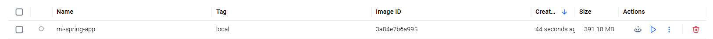
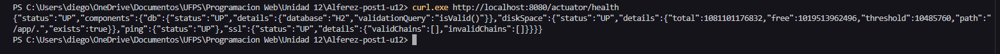
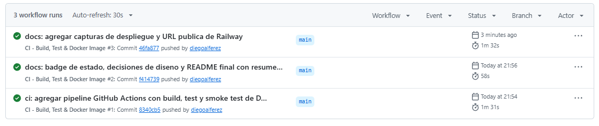
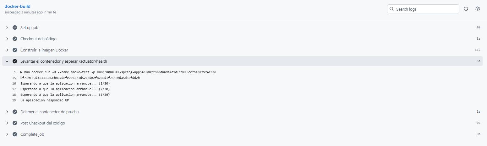
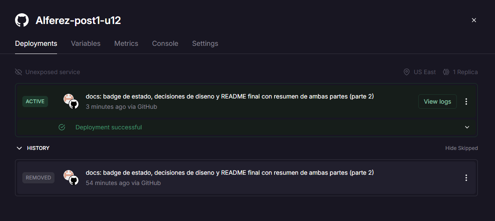
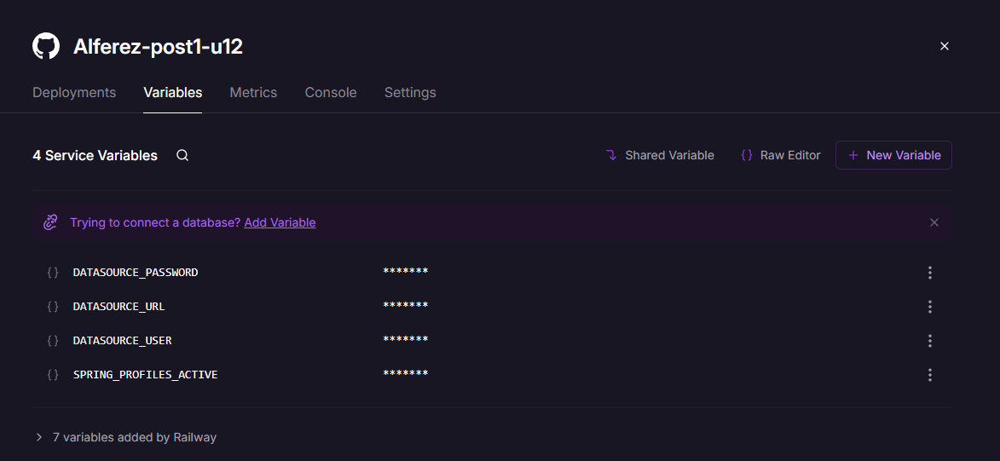
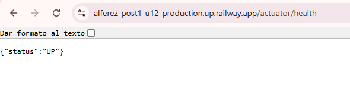

# Post-contenido — Unidad 12: Despliegue y CI/CD

## Descripción

Repositorio del laboratorio de la Unidad 12 de Programación Web.
Contiene una aplicación Spring Boot (entidad JPA `Producto` y endpoint
REST `/api/productos`) dockerizada con un Dockerfile multi-stage y
perfiles dev/prod (Parte 1), y su extensión con un pipeline de
integración continua con GitHub Actions y monitoreo con Spring Boot
Actuator (Parte 2).

## Parte 1 — Dockerización con Perfiles y Variables de Entorno

El Dockerfile multi-stage compila el proyecto con Maven en una etapa JDK
y ejecuta el JAR resultante en una etapa JRE Alpine con un usuario no
root. La configuración sensible se externaliza en `application.properties`
con placeholders `${VAR:default}`: sin variables de entorno, la aplicación
arranca con el perfil `dev` (H2 en memoria); con
`SPRING_PROFILES_ACTIVE=prod` y las variables `DATASOURCE_URL`,
`DATASOURCE_USER` y `DATASOURCE_PASSWORD`, arranca con la configuración de
producción (PostgreSQL).

## Parte 2 — Pipeline CI/CD con GitHub Actions y Monitoreo con Actuator

El pipeline (`.github/workflows/ci.yml`) se activa automáticamente en cada
push a `main` y en cada pull request, con dos jobs encadenados con `needs:`:

1. **`build-and-test`:** compila con Maven (caché de dependencias con
   `actions/setup-java`), ejecuta las pruebas con `mvn clean verify` y
   publica el reporte de Surefire como artefacto.
2. **`docker-build`:** construye la imagen Docker con el mismo Dockerfile
   de la Parte 1, levanta el contenedor dentro del propio runner y ejecuta
   un smoke test que consulta `/actuator/health` hasta obtener `UP`. Al
   final elimina el contenedor de prueba (`if: always()`). No publica la
   imagen en ningún registro externo.

## Despliegue (paso final manual)

La aplicación está desplegada en Railway a partir del mismo Dockerfile
(Railway construye la imagen por su cuenta, sin intervención del workflow),
con un servicio PostgreSQL y las variables de entorno configuradas en el
panel de la plataforma (`SPRING_PROFILES_ACTIVE=prod`, `DATASOURCE_URL`,
`DATASOURCE_USER`, `DATASOURCE_PASSWORD`):

- URL de la aplicación: https://TU-DOMINIO.up.railway.app/api/productos
- Estado de salud: https://TU-DOMINIO.up.railway.app/actuator/health

## Decisiones de diseño

### Parte 1

1. **Placeholders con valor por defecto (`${VAR:default}`) en vez de
   placeholders estrictos:** permite arrancar sin fricción en local y en
   CI, dejando los valores reales para producción.
2. **`application-dev.properties` y `application-prod.properties` como
   archivos separados:** hace explícito qué configuración corresponde a
   cada ambiente.
3. **Imagen final `eclipse-temurin:21-jre-alpine` en vez de distroless:**
   reduce el tamaño de la imagen sin sacrificar la posibilidad de depurar
   el contenedor con `docker exec`.

### Parte 2

1. **Prueba mínima de contexto en vez de omitir la fase de pruebas:**
   garantiza que el job de CI valide algo real (que Spring construye todos
   los beans con el perfil dev).
2. **El job `docker-build` construye y verifica la imagen con un smoke test
   contra `/actuator/health`, pero no la publica en ningún registro:** evita
   exigir una cuenta externa y Secrets solo para aprobar el laboratorio.
3. **Exposición de Actuator diferenciada por perfil** (todos los endpoints
   en dev, solo `health` e `info` en prod): evita exponer públicamente
   información sensible como `beans` o `env`.

## Cómo compilar y ejecutar

1. Clonar el repositorio: `git clone https://github.com/diegoalferez/Alferez-post1-u12.git`
2. Construir la imagen localmente: `docker build -t mi-spring-app:local .`
3. Ejecutar con los valores por defecto (perfil dev):
   `docker run -p 8080:8080 mi-spring-app:local`
4. Ejecutar con perfil prod (requiere un PostgreSQL accesible):
   `docker run -p 8080:8080 -e SPRING_PROFILES_ACTIVE=prod -e DATASOURCE_URL=jdbc:postgresql://host.docker.internal:5432/appdb -e DATASOURCE_USER=appuser -e DATASOURCE_PASSWORD=apppass mi-spring-app:local`
5. Verificar el estado: `curl http://localhost:8080/actuator/health`
6. Consultar el pipeline en la pestaña **Actions** del repositorio.

## Capturas de pantalla

